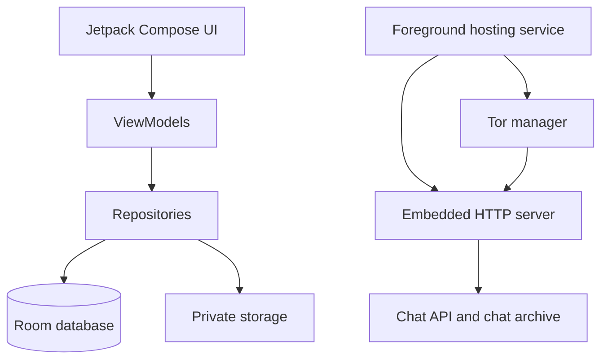

# OnionHost

OnionHost is an Android app that imports files into app-private storage and can publish them through a Tor v3 Onion Service. It also provides host-managed personal chat links and group rooms. The chat is hosted by one user's phone; it is not a peer-to-peer or end-to-end encrypted messenger.

> **Current source version:** 1.1.1 (version code 5) · **Minimum Android:** 8.0 / API 26

## Release and readiness status

This repository snapshot does **not** contain a verified, production-signed APK. A local release build can be generated, but without the maintainer's persistent release keystore it is unsigned and cannot be distributed as a production update. The previously used `releases/OnionHost-latest.apk` download link is not presented here as a current verified release.

Source verification on 2026-10-15: 36 local unit tests passed, debug lint reported 0 errors and 55 warnings, and the minified release variant packaged as `app-release-unsigned.apk`. No Android device or emulator was attached, so Tor bootstrap, actual Onion Service reachability, app-to-app chat, and responsive layouts have not been verified on hardware. These checks do not establish production readiness.

Known release blockers include plaintext chat storage/transport at the application layer (no E2EE), no shipped username directory or complete username-to-chat flow, an unsigned release without the production keystore, outstanding lint/dependency warnings, and missing live device/network testing. See the [spec track index](specs/README.md) and [chat spec](specs/002-anonymous-chat/spec.md) for details.

## Proof of concept (POC)

The screenshot below shows the complete flow: OnionHost is hosting on the phone, the generated Onion address and QR code are visible, and Tor Browser is opening the hosted directory.


## Build and install a development build

Build the debug APK from source using the steps below, then install it only for development/testing. To host content, keep the device powered and online and allow OnionHost to run its foreground service. Wait for the UI to report that the Onion Service is live before sharing its address.

## Hosting a site or file

1. In **Home**, select one of the import options:
   - **Choose Folder** for a complete static site.
   - **Choose ZIP File** to import and safely extract a site archive.
   - **Choose Single File** for an HTML file, document, APK, ISO, image, or media file.
2. OnionHost copies the content into private app storage.
3. Start hosting and wait for Tor bootstrap and hidden-service publication to finish.
4. Copy the Onion address or scan/download its QR code.
5. Stop or restart hosting from the app or its foreground notification.

The HTTP server supports directory listings when no `index.html` exists, safe MIME types, download headers for downloadable files, and byte-range requests for supported media. Optional basic authentication can be configured per website.

## QR code sharing

The Home screen shows a QR code for the active website's Onion address.

- Tap the QR code, or press **Download QR Code**, to choose a location and save it as a PNG.
- The copy icon next to the Onion address copies only the website address.
- Chat links are intentionally managed from the Chat screen, because every personal chat and room has its own separate link.

## Anonymous chat

Chat is served by OnionHost itself. No third-party chat server, phone number, or visitor account is required. A visitor needs Tor Browser and the specific link you share.

### Personal chat tab

Use **Personal** for a one-to-one room hosted by this device.

1. Start hosting from **Home** and wait for Tor publication.
2. Open **Chats → Personal → New chat**.
3. Select **Share** beside the saved chat and send the invite to the intended person.
4. Open the saved chat to view messages and approve incoming join requests.

Personal conversations stay separate from group rooms. While the Personal chat tab is open, room messages cannot be viewed or sent.

### Rooms tab

Use **Rooms** for group conversations.

1. Start hosting from **Home** and wait for Tor publication.
2. Open **Chats → Rooms**, enter a room name and tap the add/create action.
3. Tap a room to open it, then select **Share** to send its invite.
4. Approve visitors from the join-request control before they can send or read chat messages.

Each room has a different URL in this form:

```text
http://your-onion-address.onion/chat/room-room1
```

Room messages stay in their own room. While the Rooms tab is open, personal messages cannot be viewed or sent. A guest can join in OnionHost using **Join** and pasting the invite; a browser guest needs a Tor-capable browser such as Tor Browser.

### Sending, attachments, activity, and history

- Browser users receive an automatically generated anonymous name.
- The green dot shows active users who have recently connected to the currently selected conversation.
- Browser chat displays a loading spinner while the chat is loading or reconnecting.
- Text messages support up to 1,000 characters.
- Supported attachments are PNG, JPEG, GIF, WebP, MP4, WebM, MP3, OGG, and WAV, up to 5 MB.
- The host can delete any message; a browser visitor can delete messages created in that browser.
- The newest messages appear at the bottom. Scroll upward to read earlier messages.
- Saved personal-chat and room lists have a fixed height, so they do not shrink the message area when many chats exist.

### Persistence and limits

- Messages and room names are saved in the app's private storage, not inside hosted website files.
- A primary archive and local backup archive are written on every chat change. If an interrupted write damages the primary archive, the backup is restored on the next launch.
- Chats survive hosting restarts, app restarts, and normal device restarts. Clearing Android app data or uninstalling the app removes locally stored chats.
- Each room retains the latest 200 messages to keep memory use bounded.
- A private link is a locator/access secret, not end-to-end encryption. The host stores message text and attachment data in readable JSON in app-private storage and can read them. Anyone with the link can request access; host approval is the gate, and the current client ID is not a cryptographic identity.
- Tor protects the network route to an Onion Service, but it does not hide content from the hosting device or guarantee anonymity. Host availability depends on the phone, Tor, network, Android background limits, and battery settings.
- Username-based discovery is not available in the Chats UI. The repository has signed-record/client groundwork but ships no configured discovery service or complete username-to-chat workflow.

## Other app functions

| Screen | What it does |
| --- | --- |
| **Home** | Starts/stops/restarts hosting, displays the Onion address, copies the site address, and saves the address QR code. |
| **Chats** | Manages personal rooms and group rooms, invite sharing/joining, host approval, messages, attachments, activity indicators, and deletion. |
| **Websites** | Shows imported websites and lets you choose the active hosted content. |
| **Analytics** | Shows local visit/download request counts, paths, and daily statistics. The app does not persist IP or user-agent fields in visitor-stat rows; requested paths and timestamps are stored locally and may themselves reveal sensitive resource names. |
| **Logs** | Shows application, HTTP, and Tor status messages to help diagnose startup or publication problems. |
| **Settings** | Stores app preferences, including hosting-related settings. |
| **About** | Shows application information. |

## Security and privacy

- Content is imported into app-private storage before serving.
- Path-traversal protection prevents a request from escaping the hosted content root.
- MIME validation restricts served and chat-uploaded content types.
- Chat pages and APIs use no-store cache headers and a restrictive content-security policy.
- The embedded server rate-limits requests per observed address.
- Tor creates and owns the v3 hidden-service key material; OnionHost does not generate a fake Onion address.
- An Onion address only becomes shareable after Tor reports that its service descriptor has been published.
- Chat content is not end-to-end encrypted and is readable by the host. Do not use it for sensitive communications until an audited E2EE protocol, secure key verification, and encrypted storage are implemented and tested.
- Username registration/discovery is not a deployed decentralized network. Do not infer that a signed username record proves control of an Onion Service.
- The Android manifest declares `INTERNET`, network-state, foreground-service, notification, boot, and wake-lock permissions. Review the current manifest and release lint output before distribution.

## Build from source

Requirements: Android SDK API 34, JDK 17, and Android 8.0+ for running the app.

```powershell
$env:ANDROID_HOME = "C:\Users\<you>\AppData\Local\Android\Sdk"
.\gradlew.bat :app:assembleDebug
```

The debug APK is created at `app/build/outputs/apk/debug/app-debug.apk`. The
local release output is `app/build/outputs/apk/release/app-release-unsigned.apk`
unless all required persistent signing properties are configured.

Run the local checks with:

```powershell
.\gradlew.bat :app:testDebugUnitTest :app:lintDebug :app:assembleRelease
```

The source snapshot was last checked on 2026-10-15: 36 unit tests passed,
lint reported 0 errors/55 warnings, and the unsigned release variant packaged.
No device/emulator was available for runtime Tor or UI checks.

### Publish the current latest APK

Run this task after building and testing a debug APK:

```powershell
.\gradlew.bat :app:publishLatestApk
```

It copies the debug APK to `releases/OnionHost-latest.apk` for local/manual
distribution. This is a debug build, not a production release; it does not
sign the app with a production key or validate readiness. Do not publish it as
a production update.

### Production-signed APK

Production updates must always use the same private signing key. Do not commit that key. Create an untracked `keystore.properties` file in the repository root:

```properties
storeFile=C:\secure\onionhost-release.jks
storePassword=your-store-password
keyAlias=onionhost
keyPassword=your-key-password
```

Then run:

```powershell
.\gradlew.bat :app:publishProductionApk
```

When all signing properties are valid, this task builds and copies the signed
release APK to `releases/OnionHost-latest.apk`. Without them, the task skips;
`assembleRelease` can still create an unsigned APK. Keep the keystore and
properties file out of Git. A production update must use the same persistent
signing key as previous releases.

## Architecture



| Area | Responsibility |
| --- | --- |
| `ui/` | Compose screens, navigation, hosting controls, chat, and QR download UI. |
| `hosting/` | Foreground service and boot receiver. |
| `http/` | Static-file routes, chat pages/API, response headers, and media validation. |
| `tor/` | Tor process, hidden-service configuration, publication status, and Onion hostname handling. |
| `storage/` and `security/` | Content import, ZIP extraction, MIME checks, path safety, and rate limiting. |
| `database/` and `analytics/` | Local website configuration, logs, and privacy-preserving statistics. |

## Bug bounty field notes

এই নোটগুলো অনুমতিপ্রাপ্ত bug bounty ও security testing-এর জন্য একটি ব্যবহারিক
চেকলিস্ট। কোনো সাইট বা সিস্টেম পরীক্ষা শুরুর আগে তার বর্তমান program policy,
scope, নিষিদ্ধ পরীক্ষা, rate limit, এবং disclosure নির্দেশনা পড়ুন। লিখিত
অনুমতি ও scope-এ নেই এমন host, account, API, third-party service বা ডেটা পরীক্ষা
করবেন না। OnionHost দিয়ে host করা কোনো সাইটও স্বয়ংক্রিয়ভাবে পরীক্ষার অনুমতি
দেয় না।

### ১. কাজ শুরুর আগে

- Program URL, in-scope asset, out-of-scope asset, অনুমোদিত test account এবং
  যোগাযোগের পথ নোট করুন। Scope অস্পষ্ট হলে পরীক্ষা না করে program-এর কাছে জেনে
  নিন।
- নিজের test account ও synthetic data ব্যবহার করুন। বাস্তব ব্যবহারকারীর
  account বা ব্যক্তিগত তথ্য খুলে দেখা, সংরক্ষণ করা বা শেয়ার করা থেকে বিরত
  থাকুন।
- সীমিত অনুরোধ পাঠান; rate limit, availability impact, social engineering,
  phishing, malware, password spraying এবং destructive test program স্পষ্টভাবে
  অনুমোদন না করলে করবেন না।
- সময়, timezone, target, নিজের account/role, এবং প্রতিটি পরীক্ষার উদ্দেশ্য
  লিখে রাখুন। Secret, token, cookie বা ব্যক্তিগত তথ্য নোটে রাখবেন না; প্রয়োজন
  হলে নিরাপদে redact করুন।

### ২. হাতে-কলমে পরীক্ষা

- অ্যাপ বা সাইটের স্বাভাবিক flow বুঝে নিন: login, account settings, object
  access, upload/download, search, API এবং logout। প্রতিটি ধাপে কোন role কী করতে
  পারে তা লিখুন।
- একটি করে পরিবর্তন পরীক্ষা করুন। Access-control ত্রুটিতে শুধু নিজের দুইটি
  অনুমোদিত test account ও নিজের তৈরি object ব্যবহার করে যাচাই করুন। অন্যের
  object বা তথ্য দেখা গেলে সঙ্গে সঙ্গে থামুন; কেবল ন্যূনতম প্রমাণ রেখে রিপোর্ট
  করুন।
- Input validation, session handling, access control, business logic, file
  handling এবং security headers-এ বাস্তব প্রভাব খুঁজুন। শুধু scanner alert,
  version banner বা তাত্ত্বিক সম্ভাবনাকে প্রমাণিত vulnerability বলবেন না।
- ফলাফল পুনরায় যাচাই করতে সর্বনিম্ন নিরাপদ ধাপ নিন। ডেটা পরিবর্তন, মুছে ফেলা,
  বড় পরিসরে enumeration, persistence বা service disruption এড়িয়ে চলুন।

### ৩. প্রমাণ ও রিপোর্ট

প্রতিটি finding-এর জন্য লিখুন:

1. **শিরোনাম ও সারাংশ:** কী ত্রুটি, কোন in-scope asset-এ, কার ওপর প্রভাব।
2. **পরিবেশ:** তারিখ ও timezone, endpoint, প্রাসঙ্গিক role, browser/app version।
3. **পূর্বশর্ত ও ধাপ:** পরিষ্কার, ধারাবাহিক পুনরুৎপাদন ধাপ; নিজের test account
   ও synthetic object-এর পরিচয় দিন।
4. **প্রত্যাশিত বনাম বাস্তব ফল:** ত্রুটিটি কীভাবে যাচাই করেছেন এবং নিরাপত্তা
   নিয়মটি কী হওয়ার কথা ছিল।
5. **প্রভাব:** আক্রমণকারীর প্রয়োজনীয় access, আক্রান্ত ব্যবহারকারী/ডেটার ধরন,
   এবং গোপনীয়তা, অখণ্ডতা বা প্রাপ্যতার নির্দিষ্ট ক্ষতি। অনুমানকে বাস্তব
   প্রভাব হিসেবে লিখবেন না।
6. **প্রমাণ:** redact করা request/response, screenshot বা ছোট ভিডিও। Secret,
   session cookie, token ও ব্যক্তিগত তথ্য ঢেকে দিন। প্রয়োজনের বেশি তথ্য সংগ্রহ
   করবেন না।
7. **প্রতিকার-ইঙ্গিত:** সংশ্লিষ্ট trust boundary-তে server-side authorization,
   validation বা rate limit কোথায় শক্ত করা যায়—সংক্ষেপে উল্লেখ করুন।

Severity program-এর rubric অনুযায়ী নির্ধারণ করুন। CVSS দিলে vector ও ব্যবহৃত
version দিন, তবে program-এর নিজস্ব severity সিদ্ধান্তকে অগ্রাধিকার দিন। একই
মূল কারণের একাধিক উদাহরণ থাকলে একটি পরিষ্কার রিপোর্টে সংক্ষেপ করুন; duplicate
finding এড়াতে program-এর নির্দেশনা দেখুন।

### ৪. রিপোর্টের পর

- Program-এর নির্দিষ্ট reporting channel-এ দ্রুত ও গোপনীয়ভাবে জমা দিন। Public
  disclosure, social media post, বা তৃতীয় পক্ষের সঙ্গে প্রমাণ শেয়ার করার আগে
  program-এর disclosure policy ও অনুমোদন অনুসরণ করুন।
- Program-এর প্রশ্নের উত্তর দিন, নিরাপদে retest করুন, এবং অনুমোদিত কাজ শেষ হলে
  তৈরি করা test data/account সরিয়ে ফেলুন। নিজের নোট ও প্রমাণও program-এর
  retention নির্দেশনা অনুযায়ী নিরাপদে মুছুন।
- টাকা, bounty বা credit নিশ্চিত ধরে নেবেন না; যোগ্যতা ও পুরস্কার program-এর
  নিয়ম এবং triage-এর ওপর নির্ভর করে।

**থামুন এবং রিপোর্ট করুন:** scope-এর বাইরে asset, বাস্তব ব্যবহারকারীর ডেটা,
অনিচ্ছাকৃত account access, service degradation, বা ক্ষতির সম্ভাবনা দেখলে সঙ্গে
সঙ্গে পরীক্ষা বন্ধ করুন। ন্যূনতম তথ্য নোট করে program-এর নির্ধারিত নিরাপদ
যোগাযোগপথে জানান।

এই নির্দেশনা program-এর policy বা আইনগত পরামর্শের বিকল্প নয়। OnionHost দিয়ে
যে কনটেন্ট host বা share করা হয় তার দায় ব্যবহারকারীর।

## License

OnionHost is **not** released under an unrestricted MIT or Apache license. It
uses the repository's [OnionHost Source-Available License](LICENSE):

- Do not copy, publish, redistribute, modify, fork as a separate product, or
  use this project commercially without prior written permission from
  Security Talent.
- Contributions are welcome through issues and pull requests. Contributors
  retain copyright in their original work while granting the project the
  rights needed to use the contribution in official OnionHost releases.
- Unauthorized use may lead to copyright takedown requests or other remedies
  available under applicable law.

This is a custom license, not legal advice. If you need strong enforcement or
plan to distribute the project, have the license reviewed by a lawyer in the
relevant jurisdiction.

Created by [Security Talent](https://securitytalent.net).
